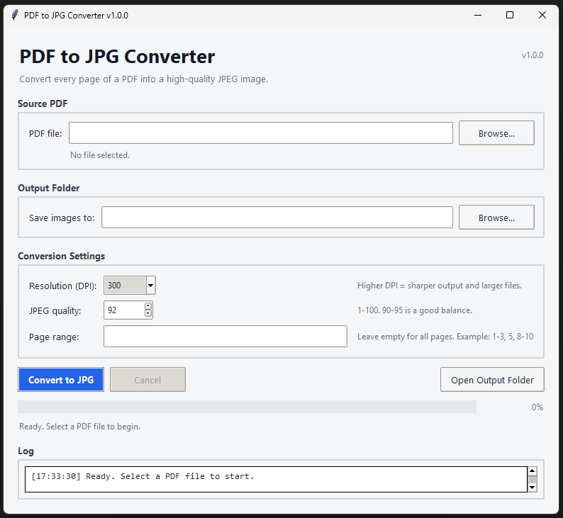

# PDF to JPG Converter

> A lightweight desktop application that converts every page of a PDF into a high-quality JPEG image — with adjustable DPI, page ranges, live progress, and cancel support.

[](https://www.python.org/)
[](https://docs.python.org/3/library/tkinter.html)
[](https://pymupdf.readthedocs.io/)
[](LICENSE)
[]()

---

## Screenshot



---

## ⬇️ Download

**[Download the latest release](https://github.com/fateh-io/pdf-to-jpg/releases/latest)** — Windows `.exe`, no Python required.

---

## Features

- **Convert all pages or a custom range** — e.g. `1-3, 5, 8-10`
- **High-quality output** — adjustable resolution from **72 to 600 DPI** (default: `300`)
- **JPEG quality control** — from `1` to `100` (default: `92`)
- **Password-protected PDFs** — prompts for the password and unlocks the file
- **Non-blocking UI** — conversion runs in a background thread
- **Live progress bar** — with a detailed log of every page
- **Cancel anytime** — pages already converted are kept
- **Auto-creates the output folder** — no manual setup
- **Safe file naming** — `document_page_0001.jpg`, `document_page_0002.jpg`, …
- **Cross-platform** — Windows, macOS, and Linux
- **Zero external binaries** — no Ghostscript, Poppler, or ImageMagick required

---

## Requirements

- **Python 3.9 or newer**
- **[PyMuPDF](https://pypi.org/project/PyMuPDF/)** (installed automatically via `requirements.txt`)

---

## Installation

```bash
git clone https://github.com/fateh-io/pdf-to-jpg.git
cd pdf-to-jpg
```

Create and activate a virtual environment:

```bash
python -m venv .venv

# Windows (PowerShell)
.venv\Scripts\Activate.ps1

# Windows (cmd)
.venv\Scripts\activate.bat

# macOS / Linux
source .venv/bin/activate
```

Install dependencies:

```bash
pip install -r requirements.txt
```

---

## Usage

```bash
python pdf_to_jpg.py
```

1. **Select a PDF file** — click *Browse…* and choose your document.
2. **Choose an output folder** — a folder named `<pdf-name>_pages` next to the PDF is suggested automatically.
3. **Adjust settings** (optional):
   - **DPI** — 72 to 600 (default `300`)
   - **JPEG quality** — 1 to 100 (default `92`)
   - **Page range** — leave empty for all pages, or use `1-3, 5, 8-10`
4. **Click “Convert to JPG”** — progress and log update live.
5. **Open the output folder** when finished.

If the PDF is password-protected, a dialog will ask for the password.

---

## Output

Each page is saved as an individually numbered JPEG file:

```text
my-document_page_0001.jpg
my-document_page_0002.jpg
my-document_page_0003.jpg
...
```

Files are written to the folder chosen in the *Output Folder* field, and are
overwritten if a file with the same name already exists.

---

## Quality Tips

| DPI | Best for |
|-----|----------|
| 72  | Quick previews, thumbnails |
| 150 | Small file size, casual reading |
| **300** | **Recommended for documents and archival** |
| 400 | Fine text, higher detail |
| 600 | Very fine details, large files |

**JPEG quality 90–95** gives a good balance between visual quality and file size. Values above 95 increase file size with minimal visible improvement.

---

## How It Works

- **PyMuPDF** renders each PDF page at the selected DPI as an RGB pixmap (no alpha channel, so JPEGs stay compatible with every viewer).
- **Pixmaps are encoded to JPEG in-memory** using the specified quality — fast and memory-friendly.
- **All I/O runs in a worker thread**, keeping the Tkinter UI responsive.
- **Progress and errors are sent back to the UI** through a thread-safe queue, polled every 100 ms.
- **Cancellation** is cooperative: the worker checks a cancellation flag between pages and finishes cleanly.

---

## Project Structure

```text
pdf-to-jpg/
├── pdf_to_jpg.py        # Main application
├── requirements.txt     # Python dependencies
├── README.md            # This file
├── LICENSE              # MIT License
├── screenshot.png       # Application screenshot
└── .gitignore
```

---

## Roadmap

- [ ] PNG and TIFF output
- [ ] Batch conversion of multiple PDFs
- [ ] Drag-and-drop file selection
- [ ] Custom application icon
- [ ] Optional grayscale mode
- [ ] PyPI package / standalone executable

Contributions and feature requests are welcome — please open an issue.

---

## License

Released under the **MIT License**. See [LICENSE](LICENSE) for details.

---

## Author

**Mohammad Fateh**
GitHub: [@fateh-io](https://github.com/fateh-io)

If you find this project useful, a ⭐ on the repository is much appreciated!